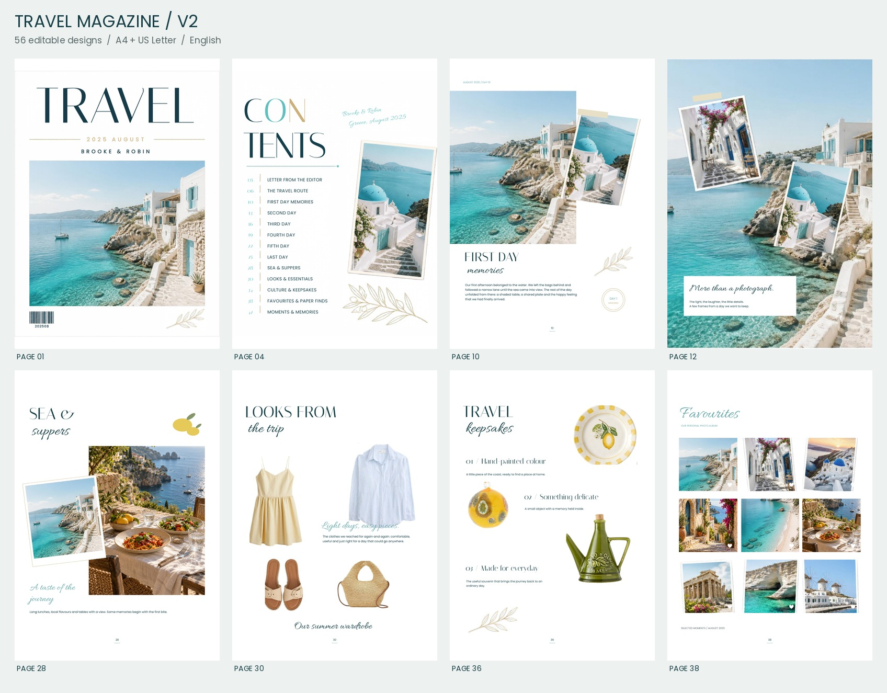

# Travel Magazine — aktuelle Version V2

Englisches Reisemagazin mit **56 Seiten** im Stil der bereitgestellten Griechenland- und Italien-Referenzen: große Serifentitel, Schreibschrift, Fotocollagen, Reiserouten, Mode, Genuss und Erinnerungsstücke. Die vorhandenen Cover, Fotos und Dekorationen werden auf Grundlage der vom Nutzer bestätigten Rechte verwendet.

## Dateien herunterladen

| Datei | Verwendung |
| --- | --- |
| [V2: Bearbeitbare A4-PowerPoint-Datei](templates/mediterranean-v2/Travel-Magazine-V2-A4.pptx) | Empfohlene Datei zum Bearbeiten und für den Canva-Import |
| [V2: PDF-Vorschau aller 56 Seiten](templates/mediterranean-v2/Travel-Magazine-V2-A4.pdf) | Aktuelle Vorlage ansehen |
| [V2: Übersicht aller Seiten](templates/mediterranean-v2/Page-Overview-V2.pdf) | Layouts vergleichen |
| [V2: Referenz, V1 und V2 im Vergleich](templates/mediterranean-v2/Vergleich-Referenz-V1-V2.jpg) | Die gestalterischen Änderungen direkt sehen |
| [V2: 52-seitige Auswahl](templates/mediterranean-v2/Travel-Magazine-V2-Main-52p.pdf) | Ein Cover, Innenseiten und eine Rückseite |
| [V2: PowerPoint im US-Letter-Format](templates/mediterranean-v2/Travel-Magazine-V2-Letter.pptx) | Format der ursprünglichen Griechenland-Datei |
| [V2: PDF im US-Letter-Format](templates/mediterranean-v2/Travel-Magazine-V2-Letter.pdf) | Letter-Vorschau aller 56 Seiten |
| [V2: Bearbeitungspaket als ZIP](downloads/Travel-Magazine-V2-Editable.zip) | A4-PPTX, Schriften und Anleitung |
| [V2: Vorschaupaket als ZIP](downloads/Travel-Magazine-V2-Previews.zip) | PDFs und Seitenübersichten |

Auf GitHub die gewünschte Datei öffnen und **Download raw file** bzw. das Downloadsymbol auswählen. Eine ZIP-Vorschau ist zum Herunterladen nicht erforderlich.

## In Canva verwenden

1. Die `.pptx`-Datei herunterladen; nicht entpacken.
2. In Canva über **Datei importieren** hochladen.
3. Schriften, Textumbrüche und Bildflächen auf jeder Seite prüfen.

Ein Canva-Import wurde nicht getestet. Ein Canva-Template-Link ist nicht enthalten. Die erste sechsseitige Vorlage enthält auch gruppierte Objekte und Bildfüllungen. Die Italien-Freisteller sind bearbeitbare Bildausschnitte aus JPG-Dateien. Schrift- und Bildauflösung sowie Ebenen nach dem Import prüfen.

## Anleitung und Vertrieb

- [Englische Bearbeitungsanleitung V2](templates/mediterranean-v2/Editing-Guide-EN.pdf)
- [Änderungen und Grenzen der Überarbeitung](templates/mediterranean-v2/AENDERUNGEN-DE.md)
- [Herkunft und Lizenzhinweise V2](templates/mediterranean-v2/ASSET-PROVENANCE.md)
- [Technischer Prüfbericht V2](templates/mediterranean-v2/Validation-Report.json)

Die neue Italien-PPTX überschritt das Transferlimit und wurde nicht geöffnet. Für den Italien-Anteil wurden die bereits vorliegenden 56 JPG-Seiten verwendet. Drei ergänzte Mittelmeerbilder sind KI-generierte illustrative Szenen. Namen, Daten und Geschichten sind Beispielinhalte.

Die bestätigten Rechte an den gelieferten Assets sind Voraussetzung für deren Verwendung. Umordnen ersetzt keine Lizenzbedingungen. Die mitgelieferten Schriften unterliegen der SIL Open Font License; die Hinweise liegen im Ordner `Fonts`. Eine eigenständige rechtliche Freigabe ist nicht enthalten.

## Vorschau

## Frühere Version

Die erste, deutlich reduzierte Fassung **The Days Between / V1** bleibt [hier archiviert](templates/the-days-between/). Ihre Anleitungen und ihr Listing-Entwurf gelten nicht für V2.
