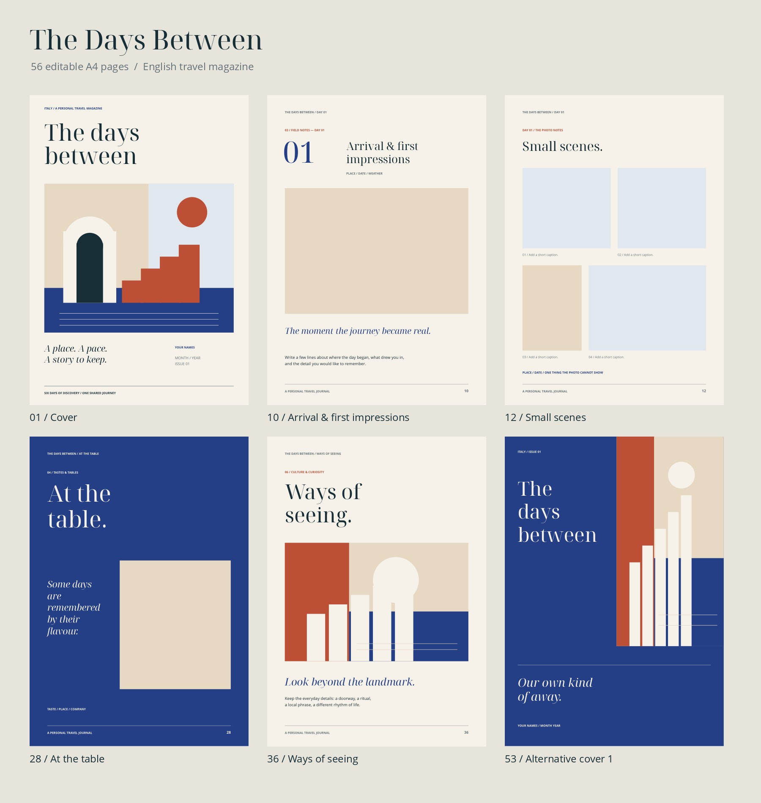

# The Days Between

Englisches Reisemagazin als bearbeitbare A4-Vorlage: **52 Magazinseiten plus vier alternative Cover/Rückseiten und 92 Bildplatzhalter**.

## Dateien herunterladen

| Datei | Verwendung |
| --- | --- |
| [Bearbeitbare PowerPoint-Datei](templates/the-days-between/The-Days-Between-A4-Editable.pptx) | Bearbeiten oder als Ausgangsdatei in Canva importieren |
| [PDF-Vorschau aller 56 Seiten](templates/the-days-between/The-Days-Between-A4-Preview.pdf) | Vorlage ansehen |
| [Übersicht aller Seiten](templates/the-days-between/Page-Overview.pdf) | Layouts vergleichen |
| [Komplettes Paket als ZIP](downloads/The-Days-Between-Complete-Package.zip) | Sämtliche Dateien inklusive Übergabe und Quelldateien |
| [Kundenpaket als ZIP](templates/the-days-between/Buyer-Download.zip) | Vorlage, PDFs, Anleitung und Schriften |

Auf GitHub die gewünschte Datei öffnen und **Download raw file** bzw. das Downloadsymbol auswählen. Eine ZIP-Vorschau ist zum Herunterladen nicht erforderlich.

## In Canva verwenden

1. Die `.pptx`-Datei herunterladen; nicht entpacken.
2. In Canva über **Datei importieren** hochladen.
3. Schriften, Textumbrüche und Bildflächen auf jeder Seite prüfen.

Ein Canva-Import wurde nicht getestet. Ein Canva-Template-Link ist nicht enthalten. Das Paket enthält die Schriftdateien; ihre Verfügbarkeit in Canva hängt von dessen Funktionen und deinem Konto ab.

## Anleitung und Vertrieb

- [Englische Bearbeitungsanleitung](templates/the-days-between/Editing-Guide-EN.pdf)
- [Deutsche Übergabe- und Vertriebshinweise](templates/the-days-between/Uebergabe-DE.pdf)
- [Etsy-Beschreibungsentwurf](templates/the-days-between/Listing-Draft-EN.md)
- [Herkunft und Lizenzhinweise](templates/the-days-between/ASSET-PROVENANCE.txt)
- [Technischer Prüfbericht](templates/the-days-between/Validation-Report.json)
- [Generator und Anleitung zur Neuerstellung](templates/the-days-between/Source/README.md)

Die Layouts, Texte und geometrischen Illustrationen wurden für dieses Projekt neu erstellt. Fotos aus der Referenz sind nicht enthalten. Die Bildflächen sind Platzhalter für eigene Inhalte.

Keine kostenpflichtigen Stockelemente erforderlich. Die enthaltenen Schriften unterliegen der SIL Open Font License 1.1 bzw. Apache License 2.0; die vollständigen Hinweise liegen im Ordner `Fonts`. Eine rechtliche Freigabe, Markenprüfung oder Garantie für den Weiterverkauf ist nicht enthalten.

## Vorschau

